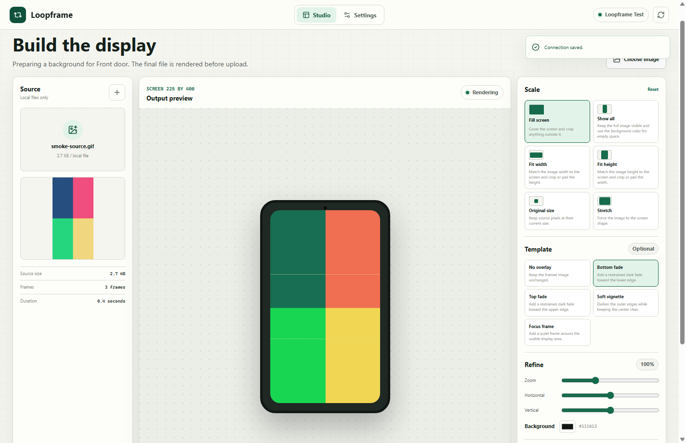
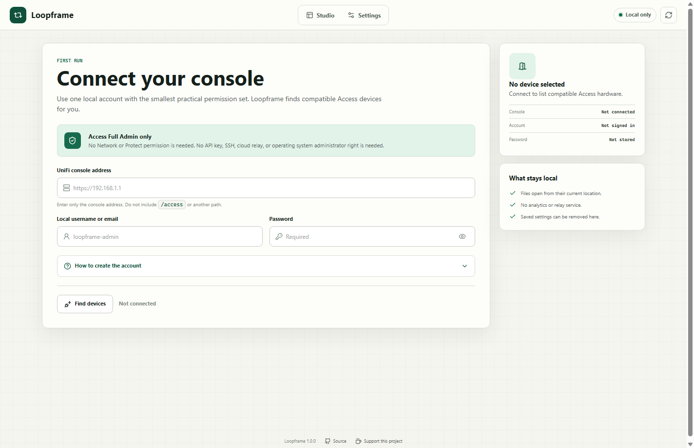
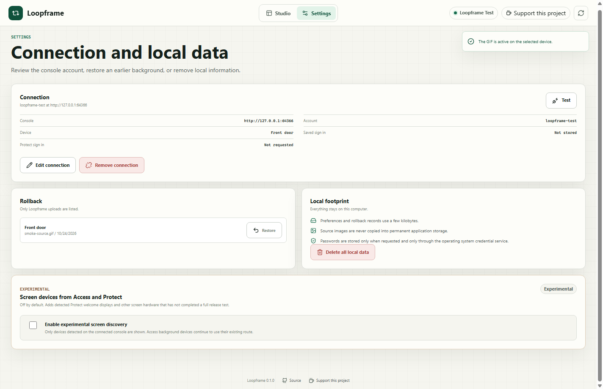
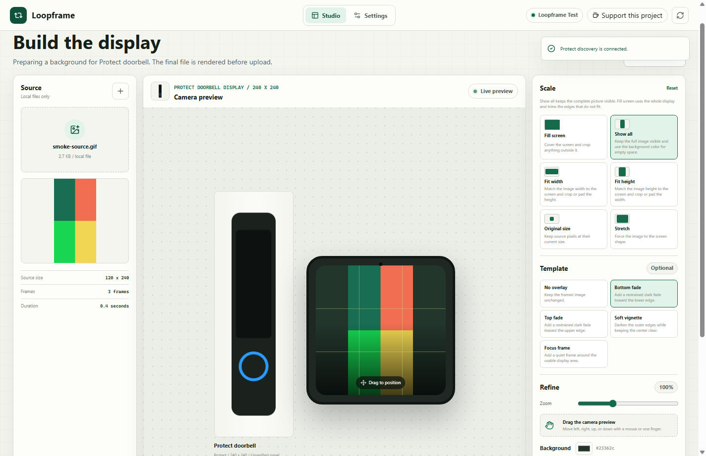

# Loopframe

Loopframe is a desktop studio for preparing animated backgrounds for UniFi
Access doorbells and intercom displays. It keeps the source file on your
computer, renders the final GIF at the display size, and uploads it with the
account you choose.



## What It Does

1. Signs in to one UniFi OS console with a local account.
2. Finds Access devices that expose background controls and have a display.
3. Can discover additional detected Access and Protect screen devices when
   the experimental setting is enabled.
4. Opens GIF, PNG, JPEG, WebP, AVIF, and TIFF files from their current folder.
5. Shows an immediate animated preview at the selected panel shape.
6. Moves the image with a mouse, touch, or the arrow keys.
7. Frames the image with six scale modes, zoom, background color, and five
   optional overlays.
8. Fetches the product image supplied by the signed in Access or Protect
   device record.
9. Renders the final animated GIF at the exact display dimensions.
10. Shows the complete animated output before publication.
11. Saves the previous Access background or Protect LCD message before
    changing it.
12. Restores the previous background or LCD message and removes the Loopframe
    Access upload on request.



## Account Requirements

Create a dedicated local admin account with only the Access application
permission.

1. Open `https://<console>/network/default/admins`.
2. Open **Roles**, then **Create New Role**.
3. Choose **Admin** and name the role `Loopframe`.
4. Set **Access** to **Full Admin**.
5. Set Network, Protect, InnerSpace, Control Plane, and every other
   application permission to **None**.
6. Open **People**, then **Add New Person**.
7. Choose **Admin** and assign the `Loopframe` role.
8. Turn on **Local Account Only**.
9. Enter a local username and password.
10. Leave **Door Access** off unless that person also needs to open doors.

Do not grant **All Applications** or **Super Admin**. Access Full Admin is
needed because UniFi does not expose a background only permission. View Only
and Door Attendant cannot change a device background.

The setup screen contains the same guidance inside the application.

When experimental screen discovery is enabled, a separate Protect account is
requested only if the current Access account cannot read Protect devices. The
Protect password uses the same protected credential service and is stored only
when the user asks to keep it.

## Supported Displays

The built in catalog contains the six confirmed screen models. The app shows
only devices that are detected on the connected console.

| Device | Studio canvas | Native panel | Status |
| --- | --- | --- | --- |
| G4 Doorbell Pro | 240 by 240 fallback | Unpublished | Protect experimental, animation unverified |
| G6 Pro Entry | 480 by 854 | 480 by 854 | Access verified, animation verified |
| Access G3 Intercom | 600 by 1024 | 1024 by 600 | Access experimental |
| Access Intercom, previous generation | 600 by 1024 | 1024 by 600 | Access experimental |
| Access Intercom Viewer | 720 by 1280 | 1280 by 720 | Access experimental |
| Access G2 Reader Pro | 286 by 1280 | 1280 by 286 | Access experimental |

UniFi lists several panels in their native landscape order while describing
the display orientation as portrait. Loopframe stores both forms and uses the
portrait canvas. A device value takes priority over the catalog.

The G4 Doorbell Pro resolution is not published by UniFi. The studio marks the
240 by 240 community fallback as unverified until the connected device
reports a value.

Access devices remain preview only when they do not expose `bg` and `bgs`.
Protect image support is experimental for the G4 Doorbell Pro until that model
completes a hardware test. See
[`docs/EXPERIMENTAL_DEVICES.md`](docs/EXPERIMENTAL_DEVICES.md) for the full
capability matrix and API notes.

The source links and model aliases are in
[`src/device-screen-catalog.json`](src/device-screen-catalog.json). Product
artwork is not copied into this repository. Loopframe downloads the image
returned by the Access or Protect device record while the user is signed in,
then caches it only in the current user's application data folder.

## Run From Source

Requirements:

1. Node.js 22 or newer.
2. A UniFi OS console with the Access application.
3. A compatible Access screen device. Protect is optional for experimental
   screen discovery.

Install and start:

```bash
npm install
npm start
```

The same commands work in PowerShell, Terminal on macOS, and a Linux shell.

The application stores non secret preferences in the current user's
application data folder. Password storage is optional. When enabled, the
password is encrypted with Electron `safeStorage`, which uses the current
user's operating system credential protection.

## Image Controls

| Control | Result |
| --- | --- |
| Fill screen | Covers the display and crops overflow |
| Show all | Keeps the full source visible and fills unused space with the selected color |
| Fit width | Matches the source width to the display |
| Fit height | Matches the source height to the display |
| Original size | Keeps source pixels at their original size |
| Stretch | Forces the source to the display shape |
| Zoom | Scales the framed result from 25 to 250 percent |
| Position | Drag the preview with a mouse or one finger |
| Fine position | Focus the preview and use the arrow keys |
| Background | Fills visible space around the source |

Available overlays are **No overlay**, **Bottom fade**, **Top fade**,
**Soft vignette**, and **Focus frame**.





## Tests

Run the local engine and rollback tests:

```powershell
npm test
```

Run the Electron interface test:

```powershell
npm run test:ui
```

Run the live console test:

```powershell
$env:LOOPFRAME_ENV_FILE = "C:\path\to\console.env"
npm run test:live
```

The live test creates a temporary Access only administrator, confirms that
Protect and Network administration are denied, tests every scale mode and
overlay against the real device, checks each prepared upload, restores the
starting background after every case, then removes the temporary account and
role.

The completed live record is in
[`evidence/07-live-end-to-end.json`](evidence/07-live-end-to-end.json).

## Package

Build the package for the computer doing the build:

```bash
npm run pack:win
npm run pack:linux
npm run pack:mac
```

Choose the command for the host system. Windows builds a portable executable
and unpacked application, Linux builds an AppImage, and macOS builds ZIP files
for Intel and Apple Silicon.

The output is written to `dist`. macOS packages should be signed and notarized
before public distribution. See [docs/PLATFORMS.md](docs/PLATFORMS.md) for the
full release matrix and user instructions.

The Windows executable prepares a private copy in the current user's
`%LOCALAPPDATA%\Loopframe\app` folder on its first run. Later launches open
that cached copy directly, which avoids paying the extraction cost again. The
unpacked ZIP can also be opened directly from any folder the user chooses.

The application does not require an installer, a system service, or operating
system administrator rights. Each user gets a separate settings folder.

## Local Data

Open **Settings** to:

1. Test the saved console connection.
2. Restore a background saved by Loopframe.
3. Remove the saved console and sign in.
4. Disable experimental screen discovery.
5. Delete the separate Protect sign in.
6. Delete every Loopframe preference, rollback record, and cached artwork.

Removing local data does not change the controller unless you choose a
rollback action first.

## Donations

The application supports one optional support destination in the header and
footer. The header link is noticeable but quiet. The application does not show
a modal, auto prompt, floating badge, or startup message.

See [docs/DONATIONS.md](docs/DONATIONS.md) for the service comparison and
configuration steps. The recommended service for Portugal is **Ko-fi** because
it supports PayPal and Stripe payments, direct settlement to your payment
account, and a free page for basic tips.

The configured support page for this release is
[`buymeacoffee.com/cfao`](https://buymeacoffee.com/cfao).

## Privacy

Loopframe connects directly to the console address you enter. It has no
analytics, telemetry, relay, or hosted account service. Source files remain in
their original folder. Prepared GIFs and rollback records stay in the current
user's application data folder.

## Limitations

The background upload uses private Access routes used by the UniFi Access web
interface. A future Access release may change those routes. The published
Access Open API does not currently expose animated background upload.

The Protect welcome image route follows the published Protect 7.3 API. The G4
Doorbell Pro path remains experimental and its animation result is unverified
until that model is tested on real hardware.

The Protect API does not publish a delete operation for uploaded device assets.
The previous on screen message is restored, but the uploaded file can remain in
the Protect asset library.

## License

MIT. See [LICENSE](LICENSE).
